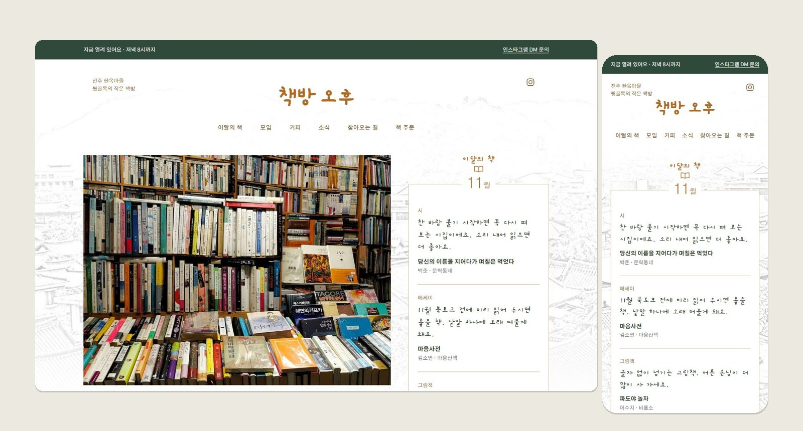
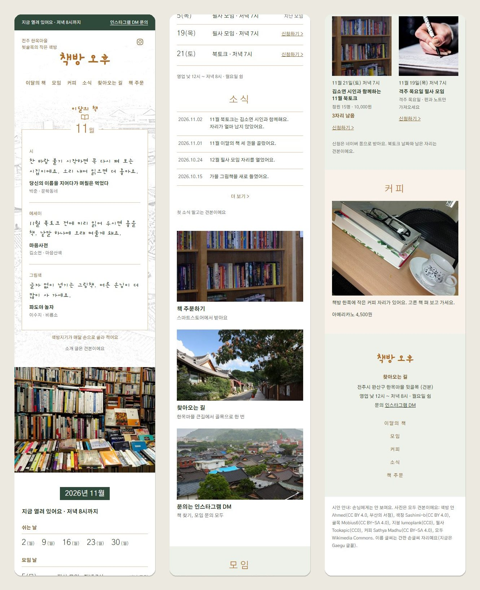
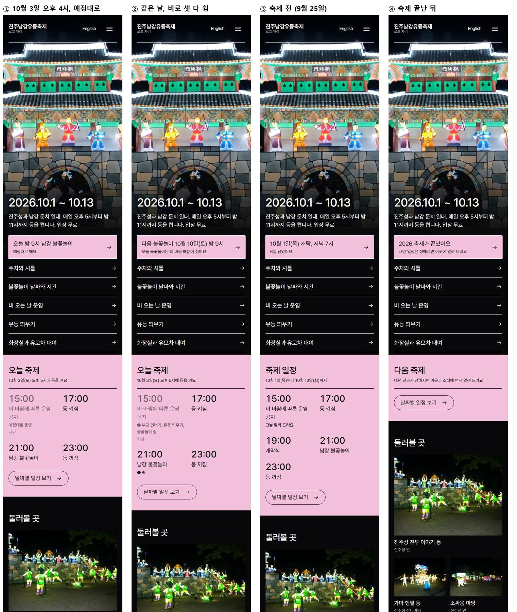
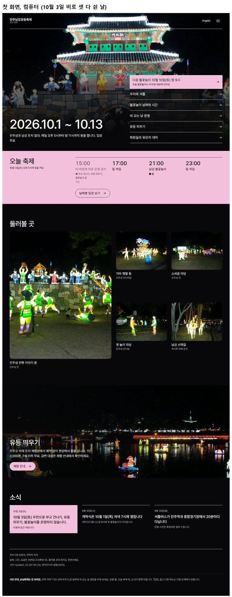

<div align="center">

# UI Design Director

### You know which sites you like. You don't know how to make yours.

A design skill that puts well-known real sites from your field side by side, lets you pick one,<br>
then measures its structure and finish and rebuilds that first page for your own shop or service.

[](#installation)
[](#installation)


[한국어](README.md) · **English**



<sub>Home page mockup for 「책방 오후」, an independent bookshop in Jeonju's hanok village. It follows the structure of Title, the Tokyo bookshop chosen as the base; the name, drawing, colours and text are the shop's own.</sub>

</div>

---

## So nobody says "this looks AI-made"

Ask an AI for a bookshop home page and you usually get the same screen: white background, one accent colour, rounded chips, photo cards, the usual fonts. There are plenty of good sites to learn from, but the model redraws the average it remembers instead of looking at them.

**ui-design-director** changes the order.

- It shows about five real sites people in your field already know, plus one or two templates, **side by side at the same size**, and asks you to pick one as the **base**.
- It measures the base's first page section by section: heights, photo share, type sizes, how the name and buttons are drawn, the colour combination. It rebuilds that, then swaps in your name, photos, colours and words.
- It leaves out what identifies the base (its logo, mascot, signature parts), so nobody looking at yours thinks "isn't this ○○?".
- Every choice is shown as a picture and answered with a number. No design vocabulary needed.

## What it makes

Both mockups below were made with this skill. A person played the client; the photos are credited free samples.

### Independent bookshop 「책방 오후」 — home page only

<table>
<tr>
<td width="46%" valign="top"></td>
<td valign="top">

**Client** a bookseller who runs a small shop alone in a back alley of Jeonju's hanok village<br>
**Wants** book-talk and copying-circle sign-ups and the monthly picks to stand out<br>
**Dislikes** big-chain bookstore feel, over-styled "aesthetic café" looks

1. Five bookshop sites (Thanks Books, Daunt Books, Books Are Magic, Title, one template) side by side; **Title** chosen as the base, because its "book of the day" card matches the monthly picks.
2. Title's structure measured and rebuilt: centred name over a pencil drawing, a framed book card with the month on its border, a large shop photo, a calendar tab, news divided by rules.
3. Title's own sky-blue square logo and street drawing left out; replaced with the shop's sign lettering and hanok-roof lines.
4. Colours from late-afternoon ochre and pine green; fonts other than the ones models always reach for.
5. "Open now · until 8 pm" updates itself from the Monday closing day and opening hours.

</td>
</tr>
</table>

### Jinju Namgang Lantern Festival — a first screen that changes with the date

<table>
<tr>
<td valign="top"></td>
<td width="30%" valign="top"></td>
</tr>
</table>

**Client** the city tourism office's festival officer · **Base** Amsterdam Light Festival (light installations on black) · **Colours** the base site's own combination

The five questions callers ask most (parking, tonight's fireworks, rain, floating a lantern, toilets and pushchairs) become first-screen shortcuts, and the "today at the festival" panel follows the date and the 3 pm go/no-go the officer enters: as planned, cancelled by rain, before the festival and after it each read differently.

<sub>Photos: festival by hyolee2 (CC BY-SA 3.0); bookshop by Ahmed, Sashimi-b (CC BY 4.0), Mobius6, Sathya Madhu (CC BY-SA 4.0), lumoplank, Tookapic (CC0) — all Wikimedia Commons.</sub>

## Quick start

Install it ([Installation](#installation)) and say:

```text
/ui-design-director A home page for our neighbourhood Pilates studio, just the home page
```

From there the skill asks one thing at a time.

```text
About the shop or service    who, what, which customers · what you dislike
→ Pick a base                ~5 real sites in the field + templates, same size, side by side
→ Pick colours and fonts     3–4 options starting from the base's colours, on the same page
→ Home page mockup           next to the base, phone and desktop, a clickable HTML page
```

A single home page ends there. For the whole site it continues the same way: a page list (`SITE-PLAN.md`), page-by-page mockups, then code.

## Rules are fixed by testing

These rules weren't written at a desk. A fresh session plays the designer and another session or a person plays the client — a café, a snack bar, a vintage shop, a festival, a second-hand market, a campsite, a Pilates studio, a bookshop. Each result is put next to one made without the skill, the "AI tells" are pointed out, and the rule that caused them is changed.

Some of what changed:

| What was pointed out | Rule that caused it | Now |
| --- | --- | --- |
| A white info panel floating on the hero photo | "Put the product's character up front" | First screen stays like the base; character comes through photos and words |
| One colour (white + a single accent) | "One accent besides black" | Carry over the base's 4–6 tones and how they relate |
| Dashed 「… 자리」 empty boxes | "Leave missing content as labelled slots" | Short sample text, flagged in one line at the foot |
| The same fonts every time | Font candidates offered from memory; a font in the palette template's example | Pick only from a table of 835 fonts (free fonts measured on the 186 most-visited Korean sites, plus company and public-body fonts on 눈누 that allow web embedding); 17 AI-default faces blocked by the hook |
| Emoji icons, wide tracking, glows | Not in the list | Signs from unslop (CC BY 4.0) added to the rules; `check_site.py` flags them |
| Browsers piling up, machine slowing | Edge's main process survived each tool | Tools close the whole process tree; the hook sweeps leftovers after every turn |

Each roleplay — what was checked and what changed — is logged in [docs/역할극-기록.md](docs/역할극-기록.md) (Korean). Tokens are measured too, aiming for one home page within an ordinary plan's limits.

## Installation

Requirements: Python 3.10+ (`python` or `python3`, with Pillow for the capture check), Node 18+, Edge or Chrome.

### Claude Code: install as a plugin (recommended)

```text
/plugin marketplace add HwangSlater/ui-design-director
/plugin install ui-design-director@ui-design-director
```

The plugin carries both skills (`ui-design-director`, `ui-wording`) and a hook. The hook acts only inside a skill project (a folder with `concept-brief.md`, `decisions.json` or `formats/board-spec.json`) and refuses:

- a viewer in `formats/` that is not the shared template (it points to `make_live_board.py`)
- a page in `palette/` not built on the palette-switcher template
- base material, palette, `DESIGN.md`, `layouts/` or `mockups/` written before the earlier stages are decided
- a palette page, mockup or `DESIGN.md` that uses a face models default to (`assets/fonts/ai-fonts.json`) — it points to `fonts.py pick`; a font the client already uses is allowed with 「의뢰인 글꼴: name」 in `concept-brief.md`

At the end of every turn, and once more when the session closes, it also clears headless browsers and temp profiles left by the measuring tools (without it, one day of roleplays left 75 browsers and 51 GB of profiles).

Why the hook is not in SKILL.md: claude.ai accepts only a fixed set of frontmatter keys and rejects an upload containing `hooks`. If you linked the skill folders as below, remove those links when you install the plugin, or each skill is listed twice.

### Claude Code: link into the personal skills folder (no hook)

```bash
# macOS and Linux
ln -s "$PWD/skills/ui-design-director" ~/.claude/skills/ui-design-director
ln -s "$PWD/skills/ui-wording" ~/.claude/skills/ui-wording
```

```powershell
# Windows (a junction works without administrator rights)
New-Item -ItemType Junction -Path "$env:USERPROFILE\.claude\skills\ui-design-director" -Target "$PWD\skills\ui-design-director"
New-Item -ItemType Junction -Path "$env:USERPROFILE\.claude\skills\ui-wording" -Target "$PWD\skills\ui-wording"
```

Link rather than copy, so repository edits reach the installation at once.

### Codex

Ask in a Codex chat:

```text
Use $skill-installer to install this skill:
https://github.com/HwangSlater/ui-design-director/tree/main/skills/ui-design-director
```

For a copied installation, place the whole folder at `~/.codex/skills/ui-design-director`:

```text
ui-design-director/
├── SKILL.md
├── agents/
├── assets/
├── references/
└── scripts/
```

Do not overwrite an existing folder of the same name without checking it first. In Codex the stage-table line at the top of SKILL.md (`!`python …stage.py``) shows as plain text; run that command in the project folder to get the same table. `${CLAUDE_SKILL_DIR}` is the skill folder.

## Usage

One line is enough, as in [Quick start](#quick-start). You can also call a single stage:

```text
Use $ui-design-director to turn my approved base and palette into project-root DESIGN.md.
Use $ui-design-director to list the pages and flows from DESIGN.md, then show mockups per page once I approve.
Use $ui-design-director to build the approved mockups. Show one representative page first.
Use $ui-design-director to review the rendered UI against DESIGN.md. Report only; do not modify files.
```

## Selection and approval rules

- Base, palette and fonts are chosen and confirmed separately. Picking a base does not decide its colours.
- For commercial products, licence comes before taste. A candidate that forbids or charges for commercial use is out.
- Delegated choices are recorded as delegated, with the reason.
- Mockups are for comparison. "Design the site" covers mockups only; production code is written only on request and for pages whose mockups are approved.
- No invented testimonials, customer logos or figures. Missing copy becomes short sample text, flagged in one line at the page foot.

## Companion skills

The open-source skills and tools below assist a stage only when installed or when the user approves the download. This skill keeps every decision and the `DESIGN.md`/`SITE-PLAN.md` files, and does not copy their text (`references/companion-skills.md`).

| Stage | Skill or tool | Licence | Part used |
|---|---|---|---|
| Format, palette, type candidates | [ui-ux-pro-max](https://github.com/nextlevelbuilder/ui-ux-pro-max-skill) | MIT | read-only search |
| Layout options | [hallmark](https://github.com/Nutlope/hallmark) | MIT | names of page shapes |
| Motion | [emilkowalski/skills](https://github.com/emilkowalski/skills) | MIT | `animate`, `review-animations` rules |
| Site check | [impeccable](https://github.com/pbakaus/impeccable) | Apache-2.0 | `npx impeccable detect` only |
| Site check | [Web Interface Guidelines](https://github.com/vercel-labs/web-interface-guidelines) | MIT | rule list |

## Repository structure

```text
.
├── skills/           ui-design-director (main skill), ui-wording (screen copy review)
├── .claude-plugin/   Claude Code plugin and marketplace metadata
├── hooks/            plugin hook (guard.py, hooks.json)
├── scripts/          repository checks (validate_skill.py, check_all.py), roleplay token count, font research
├── tests/            tool tests (pytest, node --test)
├── evals/            roleplay test briefs
└── docs/             roleplay log, README images
```

Every tool inside the skill is listed in one line in [skills/ui-design-director/TOOLS.md](skills/ui-design-director/TOOLS.md) (Korean). The model reads `SKILL.md` first and then only the `references/` files the current stage needs. 700+ design rules gathered from free lessons by practising designers, research groups and design-system teams are pulled per part with `knowledge.py` (sources in `references/design-knowledge.md`). What tends to be missed is caught by a tool rather than by more text.

## Testing

Everything at once (structure and link checks, pytest, node tests):

```bash
python scripts/check_all.py
```

One at a time:

```bash
python scripts/validate_skill.py   # skill names, frontmatter, required files, plugin config, doc links
python -m pytest -q tests          # Python tool tests
node --test "tests/*.mjs"          # browser and proxy tool tests
```

The tests replay cases where a tool misfired or missed something in a real roleplay. Why the skill changed (roleplay results, tokens) is in [docs/역할극-기록.md](docs/역할극-기록.md); per-stage tokens: `python -X utf8 scripts/roleplay_tokens.py <session ID> <phase file>`.

## Wording review — `/ui-wording`

The second skill in this repository. It aligns screen copy with the words similar services already use and unifies it across every page (cart vs basket, mixed politeness levels, "Book" vs "Book now"). It extracts all visible text (`extract_ui_text.py`), finds the inconsistencies (`term_check.py`), and applies an approved term table in one pass. It ships in the plugin; to use it alone, link `skills/ui-wording` as above.

## Licence

This repository is [MIT](LICENSE). The generated-look items adapted from unslop (Damir Sokolovsky) are CC BY 4.0, credited in `references/build-rules.md` and `scripts/check_site.py`.
