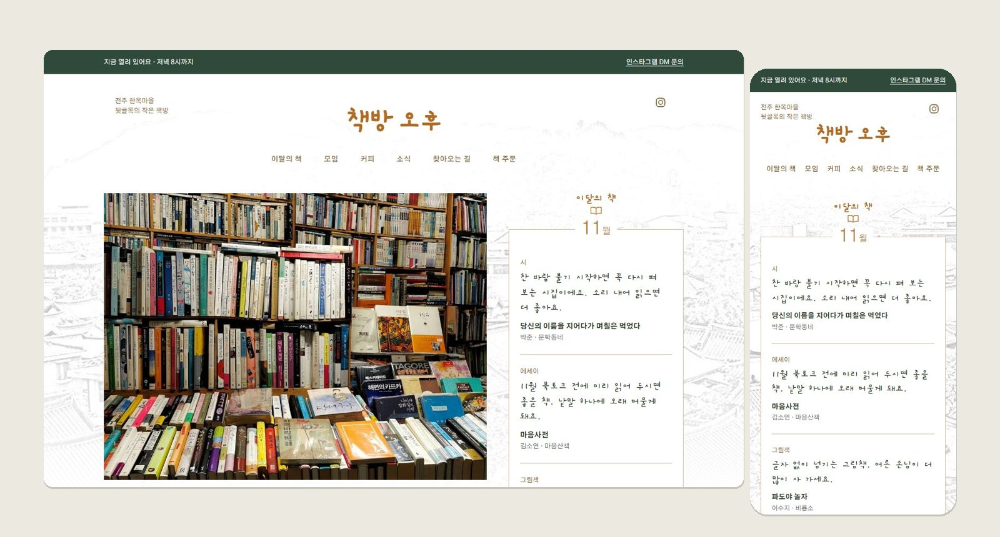
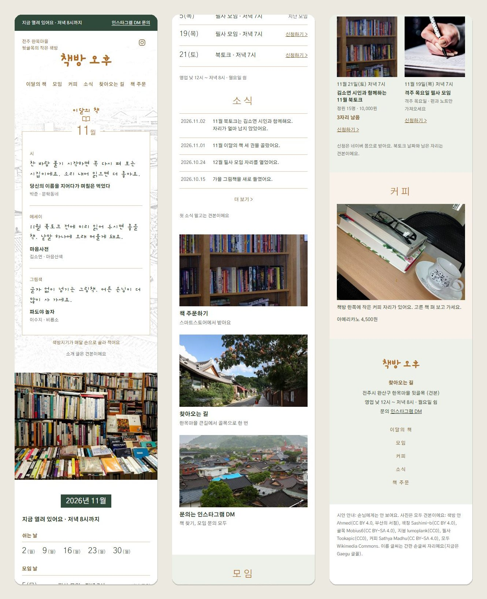
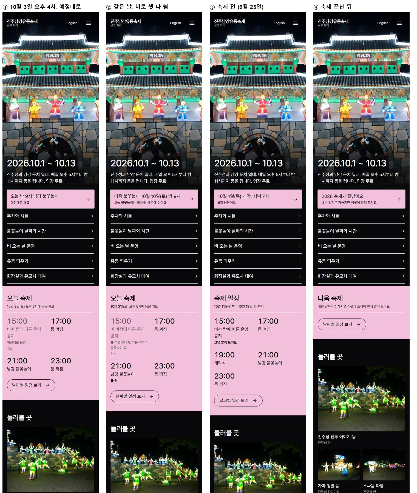
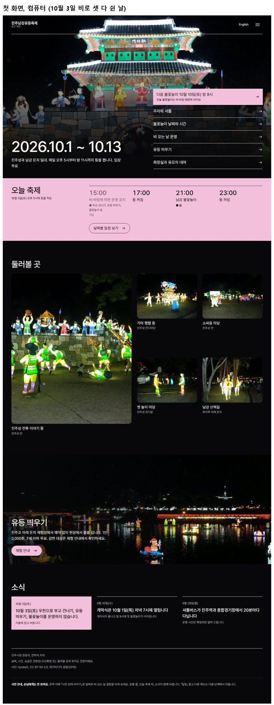

<div align="center">

# UI Design Director

### 참고할 사이트는 있는데, 우리 것은 어떻게 만들지 모를 때

같은 분야의 잘 알려진 실제 사이트를 나란히 보여 주고, 하나를 고르면<br>
그 사이트의 짜임과 마감을 재서 우리 가게·서비스의 첫 화면으로 옮겨 짓는 디자인 스킬이에요.

[](#설치)
[](#설치)


**한국어** · [English](README.en.md)



<sub>전주 한옥마을 독립 서점 「책방 오후」 메인 페이지 시안. 바탕으로 고른 도쿄 서점 Title의 짜임을 따르고, 이름·그림·색·글은 책방 오후 것으로 바꿨어요.</sub>

</div>

---

## 「AI가 만든 것 같다」는 말을 듣지 않게

AI에게 「서점 홈페이지 만들어 줘」라고 하면 대개 비슷한 화면이 나와요. 흰 바탕, 강조색 하나, 둥근 칩, 사진 카드, 늘 쓰는 글꼴. 참고할 좋은 사이트는 세상에 많은데, 그걸 보고 만드는 게 아니라 기억 속 평균을 다시 그리기 때문이에요.

**ui-design-director**는 순서를 바꿔요.

- 같은 분야에서 사람들이 이미 아는 실제 사이트 다섯 곳쯤과 템플릿 한두 개를 **같은 크기로 나란히** 보여 주고, 하나를 **바탕**으로 고르게 해요.
- 바탕의 첫 화면을 구역마다 재요. 높이, 사진 비율, 글자 크기, 이름과 단추의 생김새, 색 조합까지요. 그대로 옮겨 지은 뒤 이름·사진·색·글을 우리 것으로 바꿔요.
- 그 사이트만의 얼굴(로고, 캐릭터, 고유 부품)은 가져오지 않아요. 처음 본 사람이 「이거 ○○ 아냐?」라고 하지 않게요.
- 고를 것은 모두 그림으로 보여 주고 번호로 답하게 해요. 디자인 용어를 몰라도 돼요.

## 이렇게 나와요

두 시안 모두 이 스킬로 만들었어요. 의뢰인 역할은 사람이 맡았고, 사진은 출처를 밝힌 무료 견본이에요.

### 독립 서점 「책방 오후」 — 메인 페이지만

<table>
<tr>
<td width="46%" valign="top"></td>
<td valign="top">

**의뢰인** 전주 한옥마을 뒷골목에서 혼자 책방을 하는 책방지기<br>
**바라는 것** 북토크·필사 모임 신청과 「이달의 책」 소개가 잘 보이게<br>
**싫은 것** 큰 서점 느낌, 지나치게 꾸민 감성 카페

1. 서점 사이트 다섯 곳(땡스북스·Daunt Books·Books Are Magic·Title·템플릿 1)을 나란히 보고 **Title**을 바탕으로 골랐어요. 「매일의 책」 카드가 이달의 책과 닮아서요.
2. Title의 짜임을 재서 옮겼어요. 가운데 이름과 연필 선 그림, 테두리에 달을 걸친 책 카드, 큰 가게 사진, 달력 꼬리표, 선으로 나눈 소식.
3. Title만의 하늘색 네모 로고와 거리 그림은 빼고, 간판 손글씨와 한옥 지붕 선으로 바꿨어요.
4. 색은 오후 햇빛 같은 황토와 솔잎색, 글꼴은 모델이 늘 쓰는 글꼴이 아닌 것으로 골랐어요.
5. 「지금 열려 있어요 · 저녁 8시까지」는 월요일 휴무와 영업시간으로 저절로 바뀌어요.

</td>
</tr>
</table>

### 진주남강유등축제 — 날짜에 따라 바뀌는 첫 화면

<table>
<tr>
<td valign="top"></td>
<td width="30%" valign="top"></td>
</tr>
</table>

**의뢰인** 시청 관광과 축제 담당자 · **바탕** Amsterdam Light Festival(검은 바탕에 불빛 사진) · **색** 바탕 사이트 조합 그대로

전화로 가장 많이 오는 질문 다섯 개(주차, 오늘 불꽃놀이, 비 오는 날, 유등 띄우기, 화장실·유모차)를 첫 화면 바로가기로 올리고, 「오늘 축제」 칸이 날짜와 담당자가 오후 3시에 넣는 운영 결정에 따라 바뀌어요. 예정대로일 때, 비로 쉴 때, 축제 전, 축제 끝난 뒤가 각각 다르게 나와요.

<sub>사진: 축제 hyolee2(CC BY-SA 3.0), 서점 Ahmed·Sashimi-b(CC BY 4.0), Mobius6·Sathya Madhu(CC BY-SA 4.0), lumoplank·Tookapic(CC0) — 모두 Wikimedia Commons.</sub>

## 바로 시작하기

설치하고([설치](#설치)) 이렇게 말하면 돼요.

```text
/ui-design-director 우리 동네 필라테스 스튜디오 홈페이지, 메인 페이지만
```

그다음은 스킬이 한 번에 하나씩 물어요.

```text
가게·서비스 이야기       누가, 무엇을, 손님은 누구인지 · 싫은 느낌
→ 바탕 고르기            같은 분야 실제 사이트 5곳쯤 + 템플릿, 같은 크기로 나란히
→ 색·글꼴 고르기         바탕의 색 조합에서 출발한 3~4안, 같은 페이지에 입혀서
→ 메인 페이지 시안       바탕과 나란히, 휴대폰·컴퓨터 두 폭, 눌러 보는 HTML
```

메인 페이지 하나는 이 순서로 끝나요. 사이트 전체를 원하면 이어서 페이지 목록(`SITE-PLAN.md`), 페이지별 시안, 코드까지 같은 방식으로 가요.

## 규칙은 시험하면서 고쳐요

이 스킬의 규칙은 책상에서 정한 게 아니에요. 새 세션을 디자이너로, 다른 세션이나 사람을 의뢰인으로 두고 카페, 분식집, 구제 가게, 축제, 중고거래, 캠핑장, 필라테스, 서점까지 역할극을 돌렸어요. 매번 스킬 없이 만든 결과와 나란히 놓고 「AI 티」가 나는 곳을 짚어서 그 원인이 된 규칙을 고쳤어요.

예를 들어 이런 것들이 고쳐졌어요.

| 짚은 것 | 원인이 된 규칙 | 지금 |
| --- | --- | --- |
| 사진 위에 뜬 흰 정보 상자 | 「특색을 첫 화면 앞에」 | 첫 화면은 바탕처럼, 특색은 사진과 문구로 |
| 단색(흰 바탕 + 강조색 하나) | 「검정 말고 강조색 하나」 | 바탕의 4~6색 조합과 관계를 옮김 |
| 점선 「… 자리」 칸 | 「없는 내용은 빈칸으로」 | 견본 글로 채우고 표시는 아래 한 줄 |
| 늘 같은 글꼴 | 글꼴 규칙 없음 | 모델 기본 글꼴 금지, 무료 글꼴 사이트에서 바탕 성격에 맞춰 |

역할극마다 무엇을 봤고 무엇을 고쳤는지는 [docs/역할극-기록.md](docs/역할극-기록.md)에 남겨요. 토큰도 함께 재서, 일반 요금제에서 메인 페이지 하나를 만들 수 있는 양을 목표로 줄이고 있어요.

## 설치

### Codex: GitHub URL로 설치

이 저장소를 GitHub에 올린 뒤 Codex 채팅에서 다음처럼 요청합니다.

```text
$skill-installer로 아래 스킬을 설치해줘.
https://github.com/HwangSlater/ui-design-director/tree/main/skills/ui-design-director
```

사용자는 저장소를 복제하거나 별도 셸 명령을 실행할 필요가 없습니다. 공개 저장소는 URL에서 직접 내려받고, 비공개 저장소는 사용자의 Git 자격 증명 또는 토큰을 사용할 수 있습니다. 설치 후 다음 대화부터 `$ui-design-director`를 호출할 수 있습니다.

복사해서 설치하려면 저장소 디렉터리 전체가 다음 구조로 위치해야 합니다.

```text
repository/skills/ui-design-director/
├── SKILL.md
├── agents/
└── references/
```

동일한 이름의 디렉터리가 이미 있다면 덮어쓰지 말고 기존 설치를 먼저 확인하세요. 설치 후 스킬이 목록에 나타나지 않으면 Codex를 다시 시작하거나 새 세션을 여세요.

Codex 에서는 SKILL.md 맨 앞의 단계 표 자동 실행 줄(`!`python …stage.py``)이 명령 글자 그대로 보입니다. 그 명령을 프로젝트 폴더에서 직접 돌리면 같은 단계 표가 나옵니다. `${CLAUDE_SKILL_DIR}` 는 스킬 폴더(`~/.codex/skills/ui-design-director`)입니다.

### Claude Code: 플러그인으로 설치 (권장)

```text
/plugin marketplace add HwangSlater/ui-design-director
/plugin install ui-design-director@ui-design-director
```

플러그인에는 두 스킬(`ui-design-director`, `ui-wording`)과 훅이 같이 들어 있습니다. 훅은 스킬 프로젝트(`concept-brief.md`·`decisions.json`·`formats/board-spec.json` 이 있는 폴더) 안에서만 동작하며 이런 파일 쓰기를 막습니다.

- `formats/` 에 공용 틀이 아닌 보기 화면 HTML을 쓸 때 → `make_live_board.py` 로 만들라고 알려 줍니다
- `palette/` 에 palette-switcher 틀이 아닌 화면을 쓸 때
- 앞 단계가 확정되기 전에 바탕 자료·팔레트·`DESIGN.md`·`layouts/`·`mockups/` 를 쓸 때

훅을 SKILL.md 안에 넣지 않은 까닭은 claude.ai 업로드 때문입니다. claude.ai는 정해진 설정 항목만 받아서, `hooks` 가 있으면 업로드가 실패합니다. 그래서 SKILL.md는 어디서나 쓸 수 있게 두고, 막는 기능은 Claude Code 플러그인에만 넣었습니다. 아래처럼 스킬 폴더를 연결해 두었다면 플러그인을 설치할 때 그 연결은 지우세요. 그대로 두면 같은 스킬이 두 번 보입니다.

### Claude Code: 개인 스킬 디렉터리에 연결 (훅 없음)

`skills/ui-design-director` 디렉터리를 `~/.claude/skills/` 아래에 두면 됩니다. `SKILL.md`의 frontmatter가 그대로 호환되므로 파일은 수정할 필요가 없고, `agents/openai.yaml`이 함께 있어도 무해합니다.

저장소에서 계속 스킬을 고칠 예정이라면 복사보다 링크가 낫습니다. 저장소를 고치면 설치본에 바로 반영됩니다.

```bash
# macOS · Linux
ln -s "$PWD/skills/ui-design-director" ~/.claude/skills/ui-design-director
```

```powershell
# Windows (관리자 권한 없이 동작하는 정션)
New-Item -ItemType Junction `
  -Path  "$env:USERPROFILE\.claude\skills\ui-design-director" `
  -Target "$PWD\skills\ui-design-director"
```

연결만으로 같은 세션에서 즉시 인식되며, 다음 턴부터 `$ui-design-director` 또는 `/ui-design-director`로 호출할 수 있습니다. 링크 대신 복사해도 동작하지만, 그 경우 저장소를 고칠 때마다 다시 복사해야 합니다.

두 환경의 설치 경로는 각각 다음과 같습니다.

```text
~/.codex/skills/ui-design-director
~/.claude/skills/ui-design-director
```

## 사용법

가장 간단하게 시작하려면:

```text
$ui-design-director를 사용해서 디자인을 선정하고 싶어.
내가 디자인 용어를 잘 몰라도 한 단계씩 질문하며 이끌어줘.
```

스킬은 제품과 사용자부터 확인하고, 디자인 형식 후보, 색상 조합, 코드 시안, 최종 승인 순서로 대화를 이어갑니다. 한 번에 하나의 중요한 선택을 묻고, “모르겠어”라고 답하면 대비되는 예시나 잠정 추천으로 선택 범위를 줄여줍니다.

전체 컨셉을 처음부터 선정하려면:

```text
$ui-design-director를 사용해 이 프로젝트의 제품 성격과 사용자를 파악해줘.
적합한 실제 템플릿과 3~4색 팔레트 후보를 조사하고,
내가 디자인 형식과 색상을 각각 선택할 수 있게 해줘.
```

코드 시안까지 비교하려면:

```text
$ui-design-director로 선택한 형식과 팔레트의 최종 조합 2~3개를
동일한 콘텐츠의 간단한 UI 코드로 만들어 보여줘.
내가 승인하기 전에는 제품 UI에 적용하지 마.
```

선택한 컨셉을 문서화하려면:

```text
$ui-design-director를 사용해 승인한 디자인 형식과 팔레트를
프로젝트 루트의 DESIGN.md로 정리해줘.
관찰한 규칙, 추론한 규칙, 제품에 맞게 보정한 규칙을 구분해줘.
```

사이트 전체를 디자인하려면:

```text
$ui-design-director로 DESIGN.md를 바탕으로 이 사이트에 필요한 페이지 목록과
주요 이동 경로를 정리해줘. 승인하면 페이지 유형마다 레이아웃 시안을 보여줘.
```

승인한 시안을 코드로 옮기려면:

```text
$ui-design-director로 승인된 시안을 코드로 옮겨줘.
대표 페이지 하나를 먼저 보여 주고, 확인하면 나머지 페이지로 넓혀줘.
```

기존 구현을 검수하려면:

```text
$ui-design-director로 렌더링된 UI가 DESIGN.md를 준수하는지 검수해줘.
수정은 하지 말고 심각도와 근거를 함께 보고해줘.
```

## 선택 및 승인 원칙

- 디자인 형식, 팔레트 및 타이포그래피는 서로 구분된 선택으로 다룹니다.
- 형식 하나를 골라도 색상이 자동으로 승인되지는 않습니다.
- 3~4색 원본 팔레트와 실제 UI에 사용하는 접근 가능한 토큰을 구분합니다.
- 상업 운영 제품에서는 라이선스가 취향보다 앞선 기준입니다. 상업 이용을 금지하거나 유료로 요구하는 후보는 각주가 아니라 탈락 사유입니다.
- 사용자가 선택을 위임한 경우에도 위임 사실과 선정 근거를 기록합니다.
- 형식, 팔레트, 중요한 보정 사항 및 요청한 코드 시안 피드백이 확정돼야 `DESIGN.md`를 승인 상태로 표시합니다.
- 코드 시안은 비교용 산출물이며 제품 구현이나 승인된 디자인 시스템이 아닙니다.
- 「사이트를 디자인해 줘」는 시안까지의 승인입니다. 제품 코드는 사용자가 요청하고 해당 페이지 시안이 승인된 뒤에만 씁니다.
- 지어낸 후기·고객 로고·수치를 실제처럼 넣지 않습니다. 없으면 그 부분을 빼고, 그 밖의 빠진 글은 짧은 견본 글로 채운 뒤 페이지 아래 한 줄에 견본이라고 적습니다.

## 함께 쓰는 스킬

아래 오픈소스 스킬·도구는 설치돼 있거나 사용자가 내려받기를 허락했을 때만 해당 단계에서 보조로 씁니다. 선택과 `DESIGN.md`·`SITE-PLAN.md`는 항상 이 스킬이 맡고, 다른 스킬의 글은 복사하지 않습니다. 자세한 규칙은 `references/companion-skills.md`에 있습니다.

| 단계 | 스킬·도구 | 라이선스 | 쓰는 부분 |
|---|---|---|---|
| 형식·팔레트·서체 후보 | [ui-ux-pro-max](https://github.com/nextlevelbuilder/ui-ux-pro-max-skill) | MIT | 읽기 전용 검색 |
| 레이아웃 시안 | [hallmark](https://github.com/Nutlope/hallmark) | MIT | 페이지 구성 유형 이름 |
| 모션 | [emilkowalski/skills](https://github.com/emilkowalski/skills) | MIT | `animate`, `review-animations` 기준 |
| 사이트 점검 | [impeccable](https://github.com/pbakaus/impeccable) | Apache-2.0 | `npx impeccable detect` 검사기만 |
| 사이트 점검 | [Web Interface Guidelines](https://github.com/vercel-labs/web-interface-guidelines) | MIT | 규칙 목록 |

## 스킬 구조

```text
.
├── README.md
├── README.en.md
├── scripts/
│   └── validate_skill.py
└── skills/
    └── ui-design-director/
        ├── SKILL.md
        ├── agents/
        │   └── openai.yaml
        ├── assets/
        │   ├── dock.css · dock.js
        │   ├── board.css · board.js
        │   └── palette-switcher.css · palette-switcher.js
        ├── scripts/
        │   ├── check_site.py
        │   ├── anchor_check.py
        │   ├── page_rules.py
        │   ├── block_colours.py
        │   ├── side_by_side.py
        │   ├── make_live_board.py
        │   ├── check_shots.py
        │   ├── blind_sheet.py
        │   ├── compose_metrics.mjs
        │   ├── extract_styles.mjs
        │   ├── capture.mjs
        │   ├── make_board.py
        │   ├── skeleton.mjs
        │   ├── skeleton_base.mjs
        │   ├── preflight.py
        │   ├── judge_fill.mjs
        │   ├── live_proxy.mjs
        │   └── wait_choice.mjs
        └── references/
            ├── design-selection.md
            ├── guided-conversation.md
            ├── color-selection.md
            ├── concept-preview.md
            ├── reference-extraction.md
            ├── design-md-format.md
            ├── site-plan.md
            ├── page-design.md
            ├── mockup-content.md
            ├── owner-screens.md
            ├── blind-judge.md
            ├── site-build.md
            ├── companion-skills.md
            ├── comparison-board.md
            └── ui-review.md
```

- `SKILL.md`: 모드 선택, 승인 단계 및 공통 원칙
- `validate_skill.py`: 외부 패키지 없이 구조와 문서 링크 검증
- `guided-conversation.md`: 사용자를 한 단계씩 안내하는 대화 규칙
- `design-selection.md`: 유명 실사이트 모티브·템플릿 및 전체 디자인 형식 선정
- `color-selection.md`: 색상 조합 조사와 접근성 검토
- `concept-preview.md`: 비교 가능한 코드 UI 시안 제작
- `reference-extraction.md`: 선택한 레퍼런스에서 디자인 규칙 추출
- `design-md-format.md`: `DESIGN.md` 구조와 피드백 누적 방식
- `site-plan.md`: 페이지 목록·이동 경로·`SITE-PLAN.md` 작성
- `page-design.md`: 페이지 유형별 배치 안과 완성 시안 관문
- `mockup-content.md`: 시안에 들어갈 데이터·계산 값(영업 상태·날짜)·사진·문구·상태
- `owner-screens.md`: 사장님 화면(들어가기·폰 분실·바꾸기 전 묻기·되돌리기·바뀐 값 확인)
- `blind-judge.md`: 구성 수치 비교와 블라인드 판정(공정한 판정 그림, 결과 읽기)
- `site-build.md`: 승인된 시안을 제품 코드로 옮기는 순서와 기준
- `companion-skills.md`: 다른 오픈소스 디자인 스킬을 단계별 보조로 쓰는 규칙
- `comparison-board.md`: 후보를 보여 주는 방식(캡처, 전체 화면 보기, 팔레트 바꿔 보기)
- `capture.mjs`: 설치 없이 Edge/Chrome으로 실제 기기 폭 전체 페이지 캡처, 찍기 전 동작(상품 담기 등)·이어 찍기 지원
- `make_board.py`: 캡처로 후보 보기 화면을 만들고 캡처 작업 목록도 뽑음
- `wait_choice.mjs`: 비교 화면의 「확정」 단추를 기다렸다가 결정을 파일로 넘김(내 컴퓨터 안에서만, 한 번 쓰는 열쇠). 연결이 없으면 단추가 확정 문구를 복사해 줌
- `ui-review.md`: 렌더링 결과의 일관성 및 접근성 검수, 사이트 전체 점검
- `check_site.py`: HTML·CSS 정적 검사(외부 패키지 없음, `python scripts/check_site.py <폴더>`)
- `check_shots.py`: 보내기 전 캡처 확인(비거나 한 색뿐인 화면 — 불러오는 중·입구 화면·검은 첫 화면을 잡음)
- `blind_sheet.py`: 우리 화면과 실제 사이트 화면을 섞고 로고를 가려 새 에이전트에게 「어느 것이 AI로 만든 것인가」를 묻는 블라인드 판정 그림·요청 글
- `compose_metrics.mjs`: 넓은 화면 첫 화면의 구성(사진·색 판·빈 바탕 비율, 가장 큰 글자, 진한 색 덩어리 수, 글 폭)을 실제 사이트 여럿과 숫자로 비교해 미달 항목을 표시(작은 값이 아니라 구성을 맞추기)
- `extract_styles.mjs`: 기준 사이트에서 실제로 쓰인 글자 크기·둥글기·그림자·여백·사진과 상자 수를 뽑아 표로(글이 아니라 숫자를 보고 짜기)
- `make_live_board.py`: 참고 사이트를 캡처하지 않고 실제로 띄워 넘겨 보는 화면(다른 페이지 안에 띄우기를 막는 사이트는 표시)
- `skeleton.mjs`: 참고 사이트들의 화면 짜임을 폰·컴퓨터 따로 잰다. `--base` 로 의뢰인이 고른 템플릿을 주면 관련 사이트 여럿이 바탕과 다르게 하는 곳만 「바꿀 곳」(n/N)으로 뽑고(`skeleton_base.mjs`), 우리 시안이 바탕과 달라졌거나 상자 위에 상자를 쌓았으면 알림(같은 사이트 여러 쪽은 한 곳으로 셈)
- `preflight.py`: 의뢰인에게 보내기 전 점검 — 의뢰인이 말한 채널(네이버·인스타·카카오)이 참고와 시안에 있는지, 공통점을 셌는지, 사장님 들어가기·폰 분실, 같은 크기 단추 쌍
- `judge_fill.mjs`: 블라인드 판정용 사본만 — 견본 표시·빗금 자리 숨기기, 0000 전화번호를 그럴듯한 번호로, 남은 흔적 알림(`capture.mjs` 일감에 `"judge": true`)
- `live_proxy.mjs`: 다른 페이지 안에 띄우기를 막는 참고 사이트(네이버 지도·당근 등)도 실시간 보기 화면에 띄우는 내 컴퓨터 안 프록시 — 막는 머리 지우기, 사이트 스크립트 빼기, 후보 사이트만·읽기만·쿠키 없음
- `side_by_side.py`: 우리 화면과 기준 사이트를 같은 폭으로 나란히 놓고 시각 층 대조표를 붙인 비교 페이지

## 컨텍스트 크기

전체 스킬 지침은 약 141KB이지만 한 번에 모두 읽지 않습니다. 기본 `SKILL.md`(23KB)를 읽은 뒤 현재 작업에 필요한 참조 문서만 추가로 로드합니다. 자주 놓치는 것은 글을 늘리는 대신 `preflight.py`·`skeleton.mjs` 같은 도구가 잡게 합니다.

| 모드 | 대략적인 로드 크기 |
|---|---:|
| 기본 진입 | 23KB |
| 대화형 전체 선정 | 71KB |
| 컨셉·색상 선정 | 45KB |
| 코드 시안 | 26KB |
| DESIGN.md 추출 | 35KB |
| 사이트 계획 | 32KB |
| 페이지 시안 | 48KB |
| 코드 제작 | 27KB |
| UI 검수 | 33KB |

필요한 문서만 단계적으로 읽는 구조이므로 프로젝트 컨텍스트를 과도하게 소비하지 않습니다.

## 개발 및 검증

스킬 이름, frontmatter, 필수 파일, Codex 메타데이터, 미완성 표식 및 Markdown 링크를 검사하려면:

```bash
python3 scripts/validate_skill.py
```

도구 시험(실제 역할극에서 잘못 걸리거나 놓친 경우를 옮긴 것):

```bash
python -m unittest discover tests
node --test tests/test_judge_fill.mjs
node --test tests/test_live_proxy.mjs
node --test tests/test_skeleton_base.mjs
```

스킬을 고친 근거(역할극 결과·토큰)는 `docs/역할극-기록.md`, 구간별 토큰은 `python -X utf8 scripts/roleplay_tokens.py <세션 ID> <구간 파일>`.

공식 `skill-creator` 검증기가 설치된 개발 환경에서는 스킬 폴더를 직접 검사할 수도 있습니다.

```bash
python3 /path/to/skill-creator/scripts/quick_validate.py skills/ui-design-director
```

이 검증은 구조적 오류를 확인하며, 실제 품질을 확인하려면 템플릿 선정, 팔레트 선택, 코드 시안, `DESIGN.md` 생성의 전체 대화 흐름도 테스트해야 합니다.

## 화면 문구 검토 — `/ui-wording`

같은 저장소의 두 번째 스킬입니다. 화면 문구를 비슷한 서비스들이 쓰는 말에 맞추고 전체에서 하나로 통일합니다(카트/장바구니, 해요체/합니다체, 「예약」/「예약하기」 같은 섞임). 문구를 모두 뽑아(`extract_ui_text.py`) 흔들리는 곳을 찾고(`term_check.py`), 승인받은 용어표대로 한꺼번에 고칩니다. 설치: `skills/ui-wording` 폴더를 `~/.claude/skills/ui-wording` 으로 연결.
